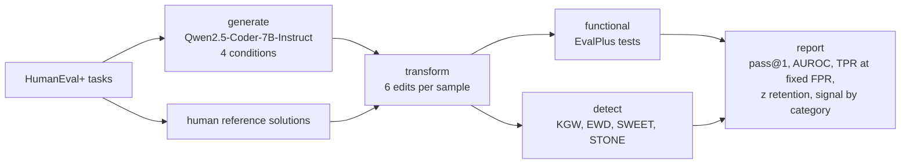

# Code Watermark Robustness

**English** | [Português](README.pt-BR.md)

**How long does an LLM code watermark survive once the code is edited?**

Watermarks for LLM-generated code bias token sampling so that a secret key can later
prove where the code came from. In practice, though, code is reformatted, cleaned up,
refactored and sometimes deliberately obfuscated. This project measures how much of
the watermark each of these edits erases, separating **routine maintenance** (what any
code goes through) from **attacks** (edits made to remove the mark), and finds out
**which parts of the code actually carry the signal**.

Final project for the Natural Language Processing course at the Federal University of
Goiás (UFG), 2026.

## What is compared

| Method | Where it watermarks | Detection needs | Paper |
| --- | --- | --- | --- |
| KGW | every token | key + tokenizer | Kirchenbauer et al., ICML 2023 |
| SWEET | tokens generated under high entropy | key + the model | Lee et al., ACL 2024 |
| STONE | non-syntactic tokens only | key + tokenizer | Kim et al., Findings of EACL 2026 |
| EWD | detector only: entropy-weighted scoring of KGW | key + the model | Lu et al., ACL 2024 |

All methods share one green-list implementation and the same strength (γ = 0.5,
δ = 1.0), so differences come from the methods, not from the hashing.

| Family | Transformations |
| --- | --- |
| maintenance | Black formatting, removing comments and docstrings |
| attack | renaming 50% / 100% of local variables, inserting dead code, minification |

Every transformed program is re-run against the EvalPlus tests to confirm it still
behaves the same.

## Pipeline



Each stage writes JSON Lines to `runs/<run_name>/` and can be resumed.

## Quick start

```bash
python -m venv .venv && source .venv/bin/activate
pip install -e ".[dev,plots]"

# Offline check of the whole pipeline with a tiny random model (CPU, ~1 minute)
python scripts/make_tiny_model.py .cache/tiny-model
cwm run configs/smoke.yaml

# Pilot on a GPU with 24 GB (20 tasks x 3 samples x 4 conditions)
cwm run configs/pilot.yaml
```

Stages can also run one at a time, and any config key can be overridden:

```bash
cwm generate   configs/pilot.yaml
cwm transform  configs/pilot.yaml
cwm functional configs/pilot.yaml
cwm detect     configs/pilot.yaml --set detectors='[kgw, stone]'
cwm report     configs/pilot.yaml
```

The report lands in `runs/<run_name>/report/` as CSV tables, `report.md` and figures.
To run on a Slurm cluster with one 24 GB GPU (e.g. an RTX 4090), see [scripts/slurm/README.md](scripts/slurm/README.md).

## Repository layout

```
configs/                experiment configs (smoke, pilot, full HumanEval+)
src/cwm/
  watermarks/           green list, KGW / SWEET / STONE processors and detectors, EWD
  transforms/           maintenance and attack transformations (LibCST, Black, python-minifier)
  evaluation/           EvalPlus checks, metrics, signal decomposition, report
  generation.py         sampling with explicit settings and a code-fence stop
  detection.py          scoring every variant with every detector
  cli.py                `cwm` command
tests/                  unit tests and an end-to-end run on a tiny model
docs/                   methodology and implementation notes
```

## Implementation notes

Details that change the numbers are documented in
[docs/IMPLEMENTATION_NOTES.md](docs/IMPLEMENTATION_NOTES.md). Highlights:

- The green list is seeded on CPU, because `torch.randperm` differs between CPU and
  CUDA for the same seed.
- The watermark runs on raw logits, before top-k, so SWEET and STONE make their
  decisions on the same distribution the detectors recompute.
- Reading the official STONE code, we found that its z-score divides by the number of
  *syntax* tokens instead of non-syntax tokens, and that merged tokens such as `"):"`
  and indentation are watermarked. Both behaviours are reproducible through options.

## Development

```bash
make lint    # ruff check + format check
make test    # full test suite, including the tiny-model end-to-end run
```

## References

- Kirchenbauer et al. *A Watermark for Large Language Models.* ICML 2023.
- Lee et al. *Who Wrote this Code? Watermarking for Code Generation.* ACL 2024.
- Kim, Park and Han. *Marking Code Without Breaking It: Code Watermarking for Detecting LLM-Generated Code.* Findings of EACL 2026.
- Lu et al. *An Entropy-based Text Watermarking Detection Method.* ACL 2024.
- Suresh et al. *Is the Watermarking of LLM-Generated Code Robust?* ICLR 2024 Tiny Papers.
- Zhang et al. *Disappearing Ink: Obfuscation Breaks N-gram Code Watermarks in Theory and Practice.* arXiv 2025.
- Liu et al. *Is Your Code Generated by ChatGPT Really Correct?* (EvalPlus). NeurIPS 2023.
- Pan et al. *MarkLLM: An Open-Source Toolkit for LLM Watermarking.* EMNLP 2024 Demo.

## License

MIT
