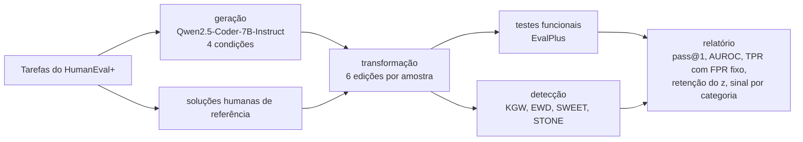

# Code Watermark Robustness

[English](README.md) | **Português**

**Quanto de uma marca d'água em código gerado por LLM sobrevive depois que o código é editado?**

Marcas d'água para código gerado por LLMs enviesam a escolha de tokens durante a
geração, de modo que uma chave secreta consiga depois provar de onde o código veio.
Na prática, porém, o código é reformatado, limpo, refatorado e às vezes ofuscado de
propósito. Este projeto mede quanto da marca cada uma dessas edições apaga, separando
**manutenção de rotina** (o que acontece com qualquer código) de **ataques** (edições
feitas para remover a marca), e investiga **quais partes do código de fato carregam o
sinal**.

Trabalho final da disciplina de Processamento de Linguagem Natural da Universidade
Federal de Goiás (UFG), 2026.

## O que é comparado

| Método | Onde marca | O que a detecção precisa | Artigo |
| --- | --- | --- | --- |
| KGW | todos os tokens | chave + tokenizador | Kirchenbauer et al., ICML 2023 |
| SWEET | tokens gerados com alta entropia | chave + o modelo | Lee et al., ACL 2024 |
| STONE | só tokens que não são de sintaxe | chave + tokenizador | Kim et al., Findings of EACL 2026 |
| EWD | só detecção: pontuação do KGW ponderada pela entropia | chave + o modelo | Lu et al., ACL 2024 |

Todos os métodos usam a mesma implementação de lista verde e a mesma força
(γ = 0,5, δ = 1,0). Assim, as diferenças vêm dos métodos, e não do hashing.

| Família | Transformações |
| --- | --- |
| manutenção | formatação com Black, remoção de comentários e docstrings |
| ataque | renomear 50% / 100% das variáveis locais, inserir código morto, minificar |

Todo programa transformado roda de novo nos testes do EvalPlus, para confirmar que
continua se comportando igual.

## Pipeline



Cada etapa grava arquivos JSON Lines em `runs/<run_name>/` e pode ser retomada de onde
parou.

## Como rodar

```bash
python -m venv .venv && source .venv/bin/activate
pip install -e ".[dev,plots]"

# Teste offline do pipeline inteiro com um modelo minúsculo e aleatório (CPU, ~1 minuto)
python scripts/make_tiny_model.py .cache/tiny-model
cwm run configs/smoke.yaml

# Piloto em uma GPU de 24 GB (20 tarefas x 3 amostras x 4 condições)
cwm run configs/pilot.yaml
```

As etapas também podem rodar uma de cada vez, e qualquer chave da configuração pode
ser sobrescrita:

```bash
cwm generate   configs/pilot.yaml
cwm transform  configs/pilot.yaml
cwm functional configs/pilot.yaml
cwm detect     configs/pilot.yaml --set detectors='[kgw, stone]'
cwm report     configs/pilot.yaml
```

O relatório fica em `runs/<run_name>/report/`, com tabelas CSV, `report.md` e figuras.
Para rodar num cluster com Slurm e uma GPU de 24 GB (por exemplo uma RTX 4090), veja
[scripts/slurm/README.md](scripts/slurm/README.md).

## Estrutura do repositório

```
configs/                configurações dos experimentos (smoke, piloto, HumanEval+ completo)
src/cwm/
  watermarks/           lista verde, processadores e detectores de KGW / SWEET / STONE, EWD
  transforms/           transformações de manutenção e de ataque (LibCST, Black, python-minifier)
  evaluation/           testes do EvalPlus, métricas, decomposição do sinal, relatório
  generation.py         amostragem com parâmetros explícitos e parada no fim do bloco de código
  detection.py          pontuação de cada variante por cada detector
  cli.py                comando `cwm`
tests/                  testes unitários e uma execução completa com um modelo minúsculo
docs/                   metodologia e notas de implementação (em inglês)
```

## Notas de implementação

Os detalhes que mudam os números estão em
[docs/IMPLEMENTATION_NOTES.md](docs/IMPLEMENTATION_NOTES.md). Os principais:

- A lista verde é sorteada na CPU, porque `torch.randperm` gera permutações diferentes
  na CPU e na CUDA para a mesma semente.
- A marca é aplicada sobre os logits brutos, antes do top-k. Assim, SWEET e STONE
  tomam suas decisões sobre a mesma distribuição que os detectores recalculam depois.
- Lendo o código oficial do STONE, encontramos que o z-score dele divide pelo número
  de tokens de *sintaxe*, e não pelo de tokens não sintáticos, e que tokens combinados
  como `"):"` e a indentação acabam sendo marcados. Os dois comportamentos podem ser
  reproduzidos por opções da configuração.

## Desenvolvimento

```bash
make lint    # ruff check + checagem de formatação
make test    # todos os testes, incluindo a execução completa com o modelo minúsculo
```

## Referências

- Kirchenbauer et al. *A Watermark for Large Language Models.* ICML 2023.
- Lee et al. *Who Wrote this Code? Watermarking for Code Generation.* ACL 2024.
- Kim, Park e Han. *Marking Code Without Breaking It: Code Watermarking for Detecting LLM-Generated Code.* Findings of EACL 2026.
- Lu et al. *An Entropy-based Text Watermarking Detection Method.* ACL 2024.
- Suresh et al. *Is the Watermarking of LLM-Generated Code Robust?* ICLR 2024 Tiny Papers.
- Zhang et al. *Disappearing Ink: Obfuscation Breaks N-gram Code Watermarks in Theory and Practice.* arXiv 2025.
- Liu et al. *Is Your Code Generated by ChatGPT Really Correct?* (EvalPlus). NeurIPS 2023.
- Pan et al. *MarkLLM: An Open-Source Toolkit for LLM Watermarking.* EMNLP 2024 Demo.

## Licença

MIT
